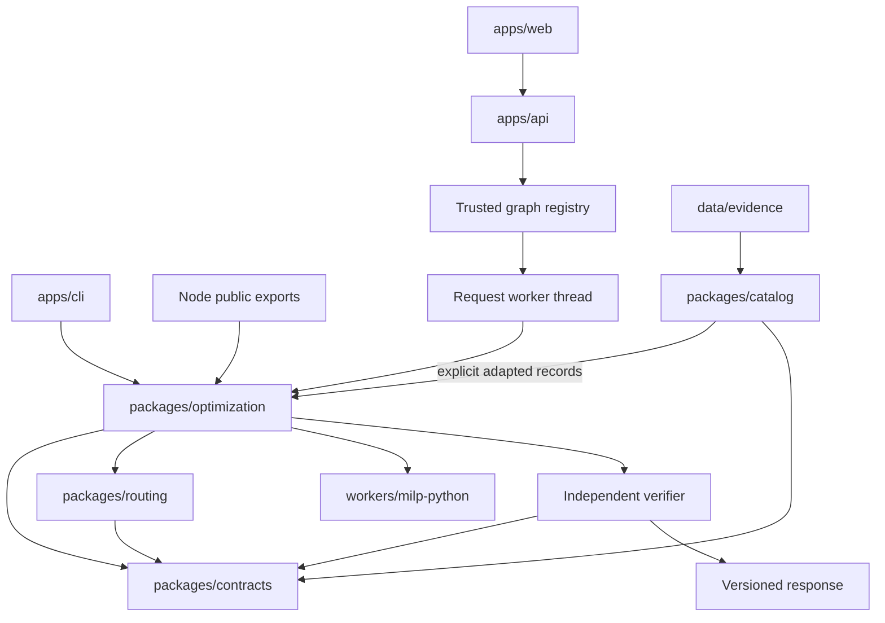

# SnowSite — implemented repository architecture (v4.10.1; migration completed v4.6)

R0–R4 directory migration is implemented in the working repository, not a proposed layout. SnowSite is a local modular monolith: Node.js applications and independent packages, local Python solver subprocess. No dependency on «Север», no remote publication or production database. The directory migration preserved v4.5 behavior; v4.7 added opt-in bounded enumeration. v4.9 retains that model, API v1.0 and module default strategy; the primary map explicitly uses bounded_enumeration.



## Physical tree

```text
SnowSite/
├── apps/
│   ├── api/                 # server, network registry, optimize-worker
│   ├── cli/                 # JSON CLI entrypoint
│   └── web/                 # map, exact page, JS, styles, vendored Leaflet
├── packages/
│   ├── contracts/           # validation, fingerprints, constraints, schemas/
│   ├── optimization/       # selection, allocation, checker, legacy, public facade
│   ├── routing/            # engine, matrix/cache, trusted file adapter
│   └── catalog/            # evidence, site adapter, geometry
├── workers/
│   └── milp-python/        # worker.py, exact-adapter.mjs, pinned requirements
├── data/
│   ├── fixtures/           # synthetic demo
│   ├── snapshots/          # pinned pkgo snapshot + source/attribution
│   └── evidence/           # historical source data, not eligible sites
├── examples/               # frozen synthetic scenarios, second graph, module example
├── tests/                  # independent oracle, API/CLI/module/invariant regression
├── tools/                  # benchmarks, check/import, browser smoke, manifest
├── docs/                   # algorithm, ADR, API, status, handoff, audits and results
├── src/                    # old import/entrypoint wrappers only
├── solver/                 # old Python launch/requirements wrappers only
├── .github/workflows/      # retained CI configuration; execution paused by owner
├── AGENTS.md
├── CHANGELOG.md
├── CONTRIBUTING.md
└── README.md
```

## Boundary contracts

| Component | Responsibility and dependency rule |
|---|---|
| contracts | Typed validation, safe selection, policy/input hashes, schemas; independent of solver, transport and file I/O. |
| optimization | Exact enumeration / unified selection, legacy compare, independent checker; depends on contracts, routing, local solver adapter. No browser, HTTP or dataset path. |
| routing | Directed distance matrix, profiles, cache and routing engine; contracts only. Operator loader is a separate file adapter. |
| catalog | Evidence and explicit site adaptation, not proof of site approval. Depends on contracts only. |
| worker | Local process protocol, cancellation, stage checkpoints, pinned Python dependencies. No imports from app packages. |
| apps | Only application layer selects files, starts HTTP/worker threads and returns responses. Web assets unchanged. |
| src / solver | Thin compatibility wrappers, never the canonical implementation. No new math here. |

The architecture regression checks the allowed static module dependency graph and verifies that checker imports only contracts. One root private Node package (`snowsite-kamchatka`) is intentionally retained: internal folder packages have explicit entrypoints; no npm workspace installation, service mesh, mandatory DB or artificial microservices. Public exports are `snowsite-kamchatka`, `/catalog`, `/network-file`; Node package version 0.3.0 and HTTP schema 1.0 are unchanged. CLI and HTTP commands still work through legacy wrappers. Raw JSON/data/schema asset paths have moved; exact mappings are in CODE_MAP/data README. No duplicate city snapshot.

## Migration gates and remaining work

| Phase | Actual result |
|---|---|
| R0 v4.5 | Stable exports and architecture plan; retained. |
| R1 | Contracts and optimization/checker extracted, schemas relocated; 93/93 tests. |
| R2 | Routing and catalogue extraction; 93/93 tests. Connector geometry not inferred. |
| R3 | Worker and adapter physically isolated; 93/93 tests. A12b proof performance was separate; closed for frozen benchmark in v4.7 below. |
| R4 | API/CLI/web and data layout relocated; 93/93 tests per commit; four new boundary/compatibility tests, 97/97 overall. Actual browser BLOCKED_ENVIRONMENT; Windows/CI PAUSED_BY_OWNER in v4.8.1. |
| R5 | Optional deployment infrastructure, not implemented. Need actual deployment requirements, auth, queues, persistence and review before exposing public service. |
| S5 WAIT_DATA | Real operational demand/capacity/road/access/legal evidence and financial model are missing. |

No change to objective or model version in this migration. Keep immutable earlier benchmarks (`docs/benchmarks/v43`–`v45`). A12b v4.7 implements proven lower-bound search in optimization package, without changing worker boundary or default. Full large Top-K beyond the frozen benchmark is not guaranteed. Source connector geometry requires explicit evidence. Do not claim actual deployment readiness or real savings.

Local Linux: Node 22.16.0, Python 3.13, SciPy 1.17.0; 97 tests passed. All 24 source payload files (MILP worker, dependencies, UI, data, schemas) match the v4.5 bytes. Browser script attempted with Python Playwright 1.57.0 and Chromium 144.0.7559.96; navigation blocked by environment (`ERR_BLOCKED_BY_ADMINISTRATOR`). CI configuration is present, not yet run remotely. See `benchmarks/v46/acceptance.md`.

## Repository governance and deployment

Owner chooses private repository and checks history for licensing and confidential material before publishing. Clone the supplied Git bundle to preserve all history; do not reinitialize or force push. `docs/10_GITHUB_SETUP.md` explains local clone and owner publication. Retain attribution/ODbL and separate source-code license decision. Use protected main and review/CI; no new dependency without justification. Record request/result hash, graph and model/solver identity, assumptions/bounds, evidence provenance for any later persistence. Keep API bound to localhost and bounded synchronous today; any future public or multi-tenant system needs authentication, authorization, resource quotas, cancellation, audit, secrets, backups and observability. Do not mistake exact finite-catalogue ranking for real-world site approval.

## Migration log

### Migration execution: R1
Contracts/schema and optimization/checker physically moved to packages/contracts and packages/optimization; src imports delegate, schema bytes unchanged. Local gate 93/93.

### Migration execution: R2
Routing engine, matrix and trusted file loader moved to packages/routing; site evidence and geometry to packages/catalog. Legacy import identity preserved. Local gate 93/93.

### Migration execution: R3
Python MILP runtime and Node subprocess adapter moved to workers/milp-python; old solver/requirements.txt and worker launcher delegate to single canonical runtime. Protocol, pins and mathematical worker unchanged. Local gate 93/93.

### Migration execution: R4
API registry and HTTP thread in apps/api, CLI in apps/cli and byte-identical web assets in apps/web. npm start/optimize use canonical entrypoints; src/server.mjs and src/cli.mjs still launch. Existing path-based tests point to canonical UI/server source; assertions unchanged. Local gate 93/93.

### Migration execution: R4-data
Immutable snapshot moved to data/snapshots/pkgo-27233df581c6; synthetic demo in data/fixtures, historical evidence in data/evidence, legacy schema in packages/contracts/schemas. All data bytes unchanged, default consumers and benchmark paths updated. Local gate 93/93.

### Migration execution: R4 acceptance
New public exports resolve directly to canonical packages; four architecture regression tests passed. 24 UI/schema/data/worker files match base v4.5 byte-for-byte. All six schema definitions and selected actual city response/catalog/registry/request validated. Python Playwright/Chromium started, but local navigation was blocked by environment policy; browser smoke source and log retained, actual E2E remains OPEN. Local gate 97/97.

### v4.7 / A12b
`packages/optimization/configuration-bound.mjs` is pure domain arithmetic; optimizer invokes it for optional `bounded_enumeration`. Same directed dependency boundaries and independent verifier. Python worker retains the same process protocol with an internal opt-in sourceTripCuts flag. No dependency, HTTP endpoint, public export, or filesystem layout change. Additive JSON v1.0 search enum/counter. Frozen scale proof PASS (1.79–2.06 s, exact Top-5), not a general service-level guarantee.

### v4.7 R4 verification automation
Independent offline schema gate under tools/; no runtime package change. CI checks and actual browser smoke have Linux/Windows matrices and manual dispatch, separate from deployment. Local JSON proof gate passed; remote Windows/browser acceptance remains OPEN.


### Deferred site data and GIS (v4.7.1)
A08-DATA / S5-SITES is a deferred research track, not a new implemented GIS package. See [DEFERRED_SITE_DATA_PLAN.md](DEFERRED_SITE_DATA_PLAN.md) for evidence acquisition and staged GIS candidates, screening, capacity/access analysis and export. Preserve current apps/packages/workers boundaries; choose additional package boundaries through ADR only when implementation is authorized. Real evidence and synthetic fixtures remain separate.

### v4.8 R4 local reliability and acceptance tooling
API static files are type-checked and read before writing headers; a missing file/directory or resolved out-of-root path returns 404, with no mathematical change. `.gitattributes` controls checkout bytes (JSON/Markdown LF, other tracked bytes unchanged). `tools/acceptance.py` is a developer/CI gate at the outer tools boundary, writes distinct reports with core/browser scope and machine versions; CI uploads those logs. Actual Windows/browser acceptance still requires a permitted target environment; no R5 deployment added without requirements.

### v4.8.1 scoped acceptance and frozen plan
No dependency/tree/runtime/solver changes. Remaining local B07/B09/B21 exercised through existing HTTP/CLI/worker boundaries; subprocess abort/recovery, missing interpreter and compact assignment verified in [v4.8.1 acceptance](benchmarks/v481/acceptance.md). Node old-generation guard is not a complete native/process-tree RSS cap; R5 requires deployment requirements before adding resource isolation. Active plan consolidated at [07_IMPLEMENTATION_PLAN](07_IMPLEMENTATION_PLAN.md); owner paused Windows and GitHub Actions, neither claimed passed. Existing browser policy block and data research deferral remain. No additional architectural scope.

v4.9 UI flow: map editor → exact-map adapter → HTTP v1 → worker → checker → compact result → canonical browser routing (distance parity check) → map. Legacy is explicit mode, not dependency/fallback for exact. Advanced v1 JSON is separate. Two allowlisted browser module paths preserve a single routing implementation; no arbitrary file exposure. No package boundary or solver change.

v4.10: same modular architecture and exact-map flow; presentation-only layout and event improvements, allowlisted `/demo-extended.json` uses existing synthetic fixture, advanced JSON download is client-side. No solver/package boundaries or contracts changed.


v4.10.1: domain boundary stabilization only. No new backend or browser module route; canonical validation via existing allowlist and a Node-side relative import bridge. Exact core and module boundaries preserved.
