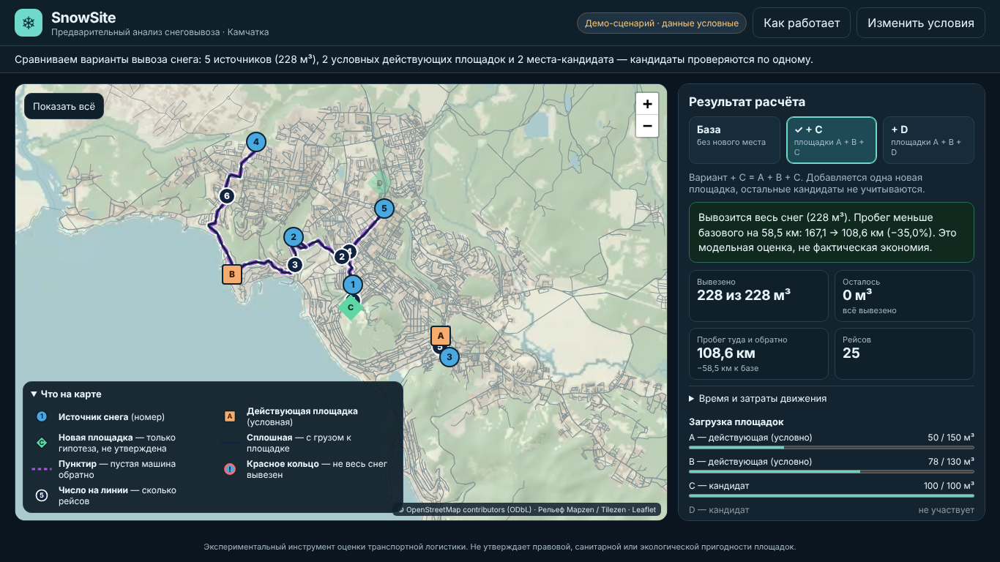
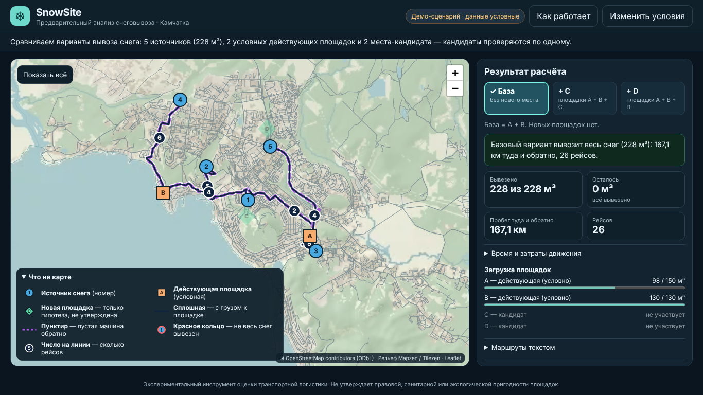
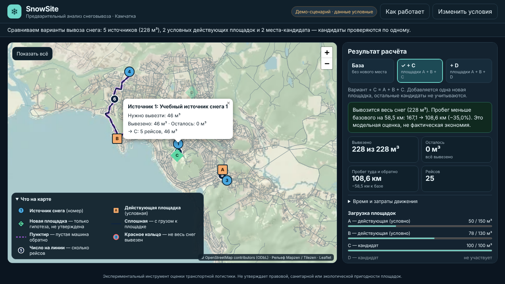
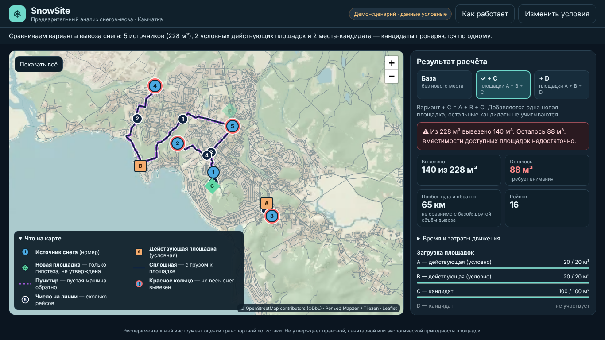
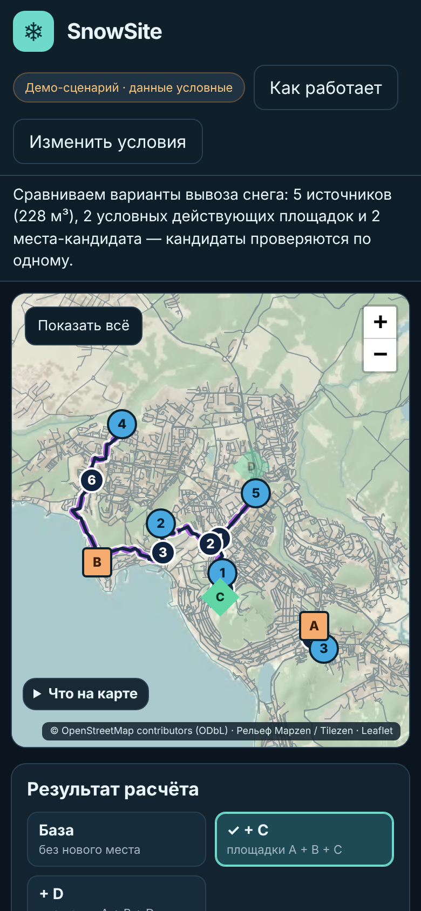

# Legacy UI — historical v4.1.1 guide

The following is historical; the exact API has different scores and constraints. Current startup and acceptance are in ../README.md and STATUS.md.

## Что работает в legacy UI (v4.1.1, сохранено)

- Карта — центр экрана: реальные дороги Петропавловска-Камчатского (OSM), рельеф, береговая линия и здания на крупном масштабе. Рядом — панель результата, всё видно без прокрутки на 1366×768.
- Постоянная легенда «Что на карте»: источник снега — голубой круг с номером, действующая площадка — оранжевый квадрат, рассматриваемая площадка — зелёный ромб (не утверждена), гружёный рейс — сплошная линия, возврат — пунктир, остаток — красное кольцо. Различие не только по цвету.
- Выбор варианта кнопками «База / + C / + D» (работает с клавиатуры). На карте остаются только маршруты выбранного варианта, неучаствующий кандидат бледнеет, линии объединены по парам «источник → площадка» с числом рейсов.
- Клик по источнику, площадке или линии показывает объём, вывезено, остаток, загрузку и рейсы.
- Главный вывод человеческим языком: «Из 228 м³ вывезено 140 м³. Осталось 88 м³: вместимости доступных площадок недостаточно…»; километры сравниваются с базой только при одинаковом вывезенном объёме.
- Показатели: вывезено / осталось, пробег туда и обратно, рейсы; время и условные затраты только на движение — в раскрывающемся блоке. Загрузка площадок, маршруты текстом, причины, таблица сравнения.
- «Изменить условия» (выдвижная панель): точки, машина, файл. Параметры не пропадают, ID не повторяются, устаревший ответ не перезаписывает результат, сброс — в два нажатия, импорт другой версии дорожной сети отклоняется.
- Без внешних API и CDN. 39 автоматических тестов + проверка хеша данных + точный эталон для малых задач; браузерные проверки — `tools/e2e.cjs` (нужен Playwright).







## Запуск

Нужен **Node.js 22+** (проверено на 22; 24 LTS тоже подходит).

**Windows, проще всего:** дважды щёлкните `START.bat` в папке проекта (откроется окно и браузер; окно не закрывать). Если не сработало — вручную: в адресной строке папки введите `cmd`, затем `node src/server.mjs` и откройте напечатанный адрес.

**Windows (PowerShell), из папки проекта:**
```powershell
node -v          # должно быть v22 или выше; если нет — установите LTS с nodejs.org
npm run check
npm test
npm start
```
Откройте **http://127.0.0.1:8793** (сервер слушает только локальный адрес). Если порт занят: `$env:PORT=8794; npm start`.

Linux/macOS — те же команды; порт: `PORT=8794 npm start`.

## Демо за 3 минуты

1. **(0:00)** Откройте сайт. Расчёт выполняется сам. Скажите: «Все точки и числа условные, дороги — реальная геометрия OSM». Покажите легенду и верхнюю строку «Сравниваем варианты…».
2. **(0:30)** Вариант «+ C» выбран: «Вывозится весь снег (228 м³). Пробег меньше базового на 58,5 км: 167,1 → 108,6 км». Подчеркните: это модельная оценка, не экономия бюджета; кандидат не утверждён.
3. **(1:00)** Переключите «База» → «+ D» (мышью или стрелками и Enter): маршруты и числа меняются, неучаствующий кандидат бледнеет. Кликните по голубой точке 1 и по линии.
4. **(1:45)** «Изменить условия» → «Точки»: уменьшите вместимость площадок A и B до 20 м³, закройте панель, «Пересчитать». Появится предупреждение «Из 228 м³ вывезено 140 м³. Осталось 88 м³…», красные кольца на источниках, а у километров пометка «не сравнимо с базой».
5. **(2:30)** «Файл» → «Скачать JSON» и «Загрузить JSON»: тот же сценарий, те же числа. «Как работает» → что модель НЕ делает.
6. **(2:50)** Заключение: земельная, санитарная и экологическая пригодность не проверена; продукт показывает логистику, а не разрешение.

## Главные ограничения legacy UI и сценарных данных

- **Данные сценарные.** Площадки, объёмы, вместимости, скорость 20 км/ч, тариф и параметры грузовика вымышленные и не подтверждены. Даже если точка попала на реальное место, это не значит, что там площадка.
- **Дорожная близость ≠ допустимость.** Продукт считает только логистику; поле `legalStatus` из JSON никогда не делает кандидата одобренным (всегда `not_assessed`).
- **Solver — эвристика**, не доказанный глобальный оптимум: жадный проход (regret-first) + локальный поиск (перенос и обмен рейсов). На малых тестах он совпал с точным перебором (300 случайных случаев), для городского масштаба это не доказано.
- Нет очередей, смен, погрузки/разгрузки, топлива, запретов поворотов, ограничений по тоннажу, высоте и сезону, состояния покрытия и CAPEX. Время и стоимость — только движение.
- Граф OSM — снимок от 19.11.2026, не официальный паспорт дорог; не подтверждает проезд тяжёлой техники.
- Кандидаты сравниваются **по одному** с базовой сетью, не как комбинация нескольких новых площадок.
- Стоимость показывается как сценарная транспортная; «экономия бюджета города» не рассчитывается и не утверждается.
- Проверка в браузере проводилась в Chromium (1366×768 и 390 px); на конкретном Windows-ноутбуке запуск нужно проверить вручную.
